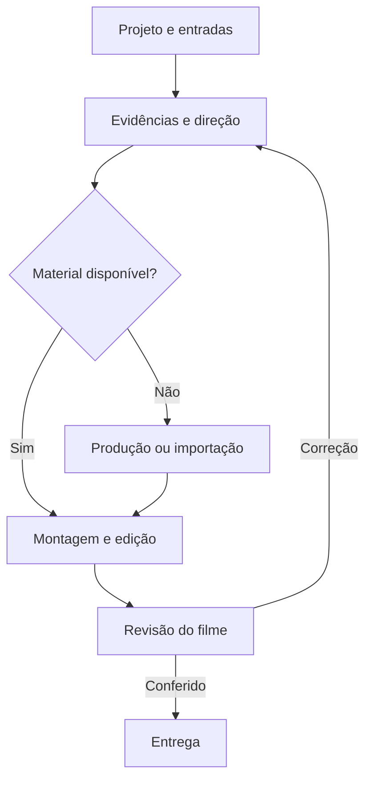

# Projeto Clone: da entrada à entrega

`python -m editorial_engine project` conecta preparação, direção, produção, geração, montagem e revisão em um projeto persistente. Cada etapa conserva os arquivos que utilizou, seus hashes e as dependências que precisam continuar válidas. `status` mostra as pendências e as próximas ações concretas.

O coordenador mantém uma única linha do tempo. O diretor decide o conteúdo, a linguagem e o propósito de cada intervenção; especialistas produzem observações, recursos ou propostas. Os executores aplicam operações declaradas. A interpretação continua no host da sessão, em um diretor humano ou em um endpoint de direção explicitamente configurado.



Este manual descreve a implementação de [project.py](../editorial_engine/project.py) e os argumentos de [project_cli.py](../editorial_engine/project_cli.py). Os exemplos de caminhos e nomes representam arquivos que o operador precisa fornecer. Publicar o motor não executa automaticamente um provedor nem revisa um filme.

## 1. As 11 entradas

O campo `intent` escolhe uma rota explícita. O sistema não deduz essa escolha pelo nome do arquivo.

| Entrada | `intent` | Caminho inicial e condição real |
| --- | --- | --- |
| 1. Editar um bruto | `edit` | Preparar a filmagem, receber direção contextual e renderizar as operações disponíveis |
| 2. Montar vários brutos | `montage` | Declarar fontes, recortes, ordem, formato, áudio e junções em um plano de montagem |
| 3. Aplicar a linguagem de uma referência | `style_transfer` | Preparar referência e bruto; registrar observações e decisões de manter/substituir; dirigir a edição |
| 4. Reconstruir uma referência com nova filmagem | `reconstruct` | Vincular dossiê e adaptação à montagem autorada de filmagens reais |
| 5. Gerar tomadas pela referência, com novos personagens | `reference_generate` | Criar direção de geração a partir do dossiê e das novas referências; produzir e receber os clipes |
| 6. Criar sem referência | `original` | Começar pelo briefing, dirigir cenas, exportar prompts e receber os resultados |
| 7. Criar com imagens, áudio ou roteiro | `media_story` | Incluir ao menos um desses recursos; usá-los como contexto e materiais de uma direção de geração |
| 8. Completar lacunas | `fill_gaps` | Identificar o contexto e os recursos ou trechos faltantes; produzir e incorporar os resultados atuais |
| 9. Personalizar um template | `template` | Selecionar biblioteca privada, variante e parâmetros; instanciar; renderizar com adaptador ou ferramenta externa |
| 10. Receber clipes produzidos fora | `returned_clips` | Adotar um plano de geração que descreva os clipes, importar os arquivos e montar os intervalos úteis |
| 11. Retomar uma revisão | `revision` | Continuar o projeto existente ou usar `fork`, preservando dependências, revisão e orçamento |

As rotas convergem nos mesmos mecanismos de montagem, acabamento, revisão e entrega. Ter uma rota cadastrada significa haver um caminho de contratos e comandos; a execução de cada especialista depende dos recursos disponíveis. Trocar a pessoa pode usar nova filmagem recortada ou novas cenas geradas. Não há face-swap embutido.

```bash
python -m editorial_engine project routes
python -m editorial_engine project --help
```

## 2. Criar, consultar e retomar o projeto

O arquivo de entrada usa `clone-project-spec/1`. Exemplo para um bruto:

```json
{
  "schema": "clone-project-spec/1",
  "id": "campanha-01",
  "intent": "edit",
  "brief": "Editar a apresentação preservando a fala e destacar somente as informações que sustentam a mensagem.",
  "inputs": [
    {
      "id": "bruto",
      "role": "footage",
      "media_type": "video",
      "status": "ready",
      "path": "/midia/bruto.mp4"
    }
  ],
  "generation_answers": {},
  "preferences": {},
  "requirements": [],
  "settings": {"max_review_retries": 2}
}
```

Uma entrada pronta precisa existir. Seu SHA-256 pode ser fornecido para conferência; quando omitido no cadastro, é calculado sobre os bytes reais. Uma entrada `needed` não pode alegar caminho ou hash. Os papéis disponíveis são `footage`, `reference`, `image`, `audio`, `script`, `resource` e `template_library`.

```bash
python -m editorial_engine project init /projetos/campanha-01 spec.json
python -m editorial_engine project status /projetos/campanha-01
python -m editorial_engine project advance /projetos/campanha-01
```

`advance` retoma a preparação local que falta e pode preparar o próximo pedido de direção. Ele para quando precisa de observações de referência, seleção entre entradas, direção ou produção. Não executa automaticamente a cadeia inteira de geração, render e aprovação.

Para completar respostas ou trocar uma entrada, edite uma cópia da especificação e registre a revisão:

```bash
python -m editorial_engine project update /projetos/campanha-01 spec-revisada.json \
  --reason "Nova filmagem e duração final confirmadas"
```

O estado salvo usa `clone-project/1`. O diretório contém `project.json`, snapshots em `revisions/`, artefatos em `work/` e, quando usado, o ledger de produção `jobs.sqlite`. Atualizações conservam o histórico; operações que dependiam dos dados alterados ficam `stale`. Não edite o estado selado à mão nem marque um arquivo pendente como pronto para contornar uma conferência.

O projeto diferencia hash canônico de um objeto JSON e hash dos bytes de um arquivo. Um plano ou recibo pode ter seu próprio selo canônico, enquanto o registro do projeto também identifica os bytes do JSON salvo. Esses hashes têm funções próprias.

`status` informa artefatos, caminhos, motivos de invalidação, tarefas de produção e revisão. Pela API, `project.artifact(diretorio, chave)` lê um artefato atual com conferência dos arquivos; `project.load_project` lê o estado persistente. O diretório do projeto está vinculado à sua localização original. A entrega gera um mapa para arquivamento, mas não implementa restauração automática em outro caminho.

As funções que alteram o projeto retornam o estado atualizado. Para obter o recibo produzido, leia o artefato correspondente. Exemplo equivalente à montagem pela CLI:

```python
import json
from pathlib import Path
from editorial_engine import project

directory = "/projetos/filme"
plan = json.loads(Path("montagem.json").read_text(encoding="utf-8"))
project.plan_assembly(directory, plan)
state = project.render_project(directory, kind="assembly")
rendered = project.artifact(directory, "render")
status = project.project_status(directory)
```

As passagens entre etapas ficam identificadas no projeto:

| Etapa | Chaves de artefatos |
| --- | --- |
| Preparação e referência | `analysis:<entrada>`, `catalog:<entrada>`, `dossier:<referência>`, `adaptation:<referência>` |
| Direção | `edit_request`, `edit_bundle`, `generation_request`, `generation_plan` |
| Prompts e retornos | `prompt_pack`, `return:<clipe>` |
| Produção | `production:<pedido>`, `execution:<pedido>`, `result:<pedido>` |
| Filme e revisão | `assembly_plan`, `render`, `review_plan`, `review` |
| Pacote entregue | `delivery` |

`request_direction`, `accept_direction`, `export_prompts`, `receive_clip`, `queue_production`, `receive_production`, `fulfill_asset`, `adopt_production`, `prepare_with_results`, `render_project`, `review_project` e `deliver_project` expõem os mesmos estágios em Python. `produce` acrescenta a possibilidade de receber um callback ou registro de adaptadores do host.

## 3. Editar uma filmagem real

```bash
python -m editorial_engine project prepare /projetos/campanha-01 bruto
python -m editorial_engine project request /projetos/campanha-01 --kind edit --input bruto
```

`prepare` extrai evidências técnicas e amostras, e prepara o catálogo de operações utilizáveis. Recursos como transcrição, pose, mattes e projeção podem ser fornecidos com `--resources recursos.json`. A descrição do recurso não substitui seu arquivo nem prova cobertura suficiente.

O pedido de direção fica no artefato `edit_request`. O diretor no host inspeciona as evidências e produz a resposta estruturada. Para adotá-la:

```bash
python -m editorial_engine project plan /projetos/campanha-01 direcao-edicao.json \
  --kind edit --input bruto
python -m editorial_engine project render /projetos/campanha-01 --kind edit
```

Também é possível chamar uma vez um endpoint de direção configurado:

```bash
python -m editorial_engine project direct /projetos/campanha-01 --kind edit \
  --endpoint "$CLONE_DIRECTOR_ENDPOINT" --model "$CLONE_DIRECTOR_MODEL" \
  --api-key-env CLONE_DIRECTOR_API_KEY
```

A credencial é lida do ambiente, sem ser gravada no plano. `direct` adota a resposta validada; não é preciso rodar `plan` de novo sobre o mesmo retorno. Fonte tipográfica e estilo de render, quando exigidos pelas operações, podem ser fornecidos em `render --font`, `--script-font` e `--style`.

O render contextual trabalha sobre uma fonte com seu relógio preservado. Para cortar vários arquivos ou alterar a ordem dos trechos, use a montagem antes do acabamento. Os detalhes do catálogo, dos efeitos e dos recursos estão em [contextual-editing.md](contextual-editing.md).

## 4. Criar vídeo original e receber clipes

Use `intent="original"`, entradas vazias quando não houver material e `generation_answers` para respostas já conhecidas. Objetivo, público, proporção, duração, idiomas, falas e decisões de áudio devem ser resolvidos conforme o projeto. O briefing pode registrar perguntas pendentes; não é necessário escolher um fornecedor antes de escrever a direção.

```bash
python -m editorial_engine project request /projetos/filme-original --kind generation
python -m editorial_engine project plan /projetos/filme-original plano-geracao.json --kind generation
python -m editorial_engine project export /projetos/filme-original
```

O plano aceito usa `video-generation-plan/1`. O pedido `generation_request` tem um contrato próprio; `direct --kind generation` chama o adaptador de direção correspondente, com os mesmos argumentos `--endpoint`, `--model` e `--api-key-env`. Essa chamada retorna direção e dados. Ela não chama um modelo gerador de vídeo.

Pedidos podem incluir imagens reais verificadas, até o limite declarado por `--max-frames`; `--no-images` desativa o envio das imagens. São amostras estáticas. Prepará-las ou enviá-las não comprova observação contínua do movimento nem audição. Roteiros em entradas `script` são carregados como conteúdo do projeto; imagens e áudios declarados entram como recursos a reutilizar.

`export` salva JSON, Markdown e um TXT por clipe. Com um perfil de capacidade efetivamente conferido, use:

```bash
python -m editorial_engine project export /projetos/filme-original \
  --profile capacidade-verificada.json --ready
```

`--ready` exige requisitos suficientes para exportar cada clipe pronto; não garante que a ferramenta produzirá uma cena fiel. O fluxo continua manual quando o usuário leva os prompts à ferramenta escolhida. Depois da produção:

```bash
python -m editorial_engine project receive /projetos/filme-original clip-01 /midia/clip-01.mp4
```

Quando a próxima cena depende de um quadro observado do retorno anterior:

```bash
python -m editorial_engine project receive /projetos/filme-original clip-01 /midia/clip-01.mp4 \
  --selected-frame 299 --observation observacao-fronteira.json
python -m editorial_engine project export /projetos/filme-original \
  --profile capacidade-verificada.json --ready
```

O índice do exemplo precisa ser substituído por um quadro existente e escolhido. A observação declara autor, método, escopo, janela conferida e decisão de continuidade. Escolher um quadro anterior não autoriza trim automático: revise o intervalo útil no plano. Reexportar depois da recepção vincula o próximo prompt ao quadro real. O recibo registra a relação com o pacote exportado; não atesta que o fornecedor respeitou os anexos.

Para a rota `returned_clips`, adote primeiro o plano que descreve a ordem, os intervalos e as ligações dos vídeos recebidos. Não basta cadastrar MP4s sem dizer como entram no filme. Veja os contratos de direção, fronteiras e áudio em [video-generation.md](video-generation.md).

## 5. Usar uma referência e uma nova pessoa

Cadastre o vídeo de referência com `role="reference"`. Para edição sobre filmagem real, mantenha o novo bruto separado com `role="footage"`.

```bash
python -m editorial_engine project prepare /projetos/recriacao referencia
python -m editorial_engine project reference /projetos/recriacao referencia observacoes.json \
  --author autor.json --adaptation adaptacao.json
```

As observações usam evidências da preparação e declaram aspecto, descrição, intervalo, confiança e escopo. O dossiê `reference-direction-dossier/1` registra interpretação atribuída. A adaptação `reference-adaptation/1` decide `keep` ou `replace` para cada aspecto observado e identifica novas referências de identidade, figurino, cenário ou objeto. Se a adaptação vier depois, use `project adapt PROJETO referencia adaptacao.json`.

Para transferir linguagem ao bruto:

```bash
python -m editorial_engine project prepare /projetos/recriacao bruto
python -m editorial_engine project request /projetos/recriacao --kind edit \
  --input bruto --reference referencia
```

Para gerar novas tomadas com novos personagens:

```bash
python -m editorial_engine project request /projetos/recriacao --kind generation \
  --reference referencia
```

A reconstrução por filmagens reais usa `assemble --plan montagem.json --reference referencia`. O dossiê passa ao contexto e às dependências; não cria automaticamente uma montagem equivalente nem recupera recursos ocultos do vídeo. Recortar a nova pessoa, produzir identidade visual e reconstruir uma cena continuam trabalhos explícitos. A fonte dos contratos é [reference_direction.py](../editorial_engine/reference_direction.py).

## 6. Produção e recursos faltantes

Uma solicitação `production-request/1` é um registro selado de necessidade, entradas, parâmetros, saída esperada, limitações e vínculos com a fonte. Use o construtor Python para gerar o JSON corretamente:

```python
import json
from pathlib import Path
from editorial_engine.production import production_request

request = production_request(
    "imagem-produto", "chat_image",
    prompt="Descrição autorada da imagem necessária, com suas referências e função na cena.",
    output_kind="image",
)
Path("pedido-imagem.json").write_text(
    json.dumps(request, ensure_ascii=False, indent=2), encoding="utf-8"
)
```

```bash
python -m editorial_engine project queue /projetos/recriacao pedido-imagem.json
python -m editorial_engine project produce /projetos/recriacao imagem-produto
python -m editorial_engine project receive-resource /projetos/recriacao imagem-produto \
  /midia/produto.png --provenance proveniencia-producao.json
```

A proveniência de produção exige `actor`, `method` e `simulated` booleano. Preencha com o responsável, o procedimento real e a condição real do resultado. Uma saída simulada permanece identificada e não pode cumprir uma necessidade de produção. Receber um arquivo verifica bytes, tipo e restrições; não significa que sua aparência foi aprovada.

As funções abaixo têm papéis próprios:

| Comando | Efeito |
| --- | --- |
| `queue PROJETO pedido.json` | Registra uma necessidade tipada; não executa comandos contidos em dados |
| `queue-assets PROJETO` | Gera pedidos `asset-<id>` para recursos `needed` do plano de geração atual |
| `produce PROJETO pedido` | Para geração de vídeo, exporta o pedido e aguarda retorno externo; demais operações executam adaptador autorizado ou exportam a tarefa |
| `receive-resource PROJETO pedido arquivo --provenance origem.json` | Importa resultado externo real do tipo solicitado |
| `fulfill PROJETO asset_id pedido` | Incorpora o resultado à lacuna exata de uma nova revisão do plano de geração |
| `adopt PROJETO pedido nova-entrada --role PAPEL --purpose TEXTO` | Cadastra o resultado como nova entrada concreta do projeto |
| `prepare-resources PROJETO bruto bindings.json` | Liga resultados de preparação à análise daquela fonte |

Exemplo para uma imagem faltante já declarada no plano:

```bash
python -m editorial_engine project queue-assets /projetos/recriacao
python -m editorial_engine project produce /projetos/recriacao asset-personagem
python -m editorial_engine project receive-resource /projetos/recriacao asset-personagem \
  /midia/personagem.png --provenance proveniencia-producao.json
python -m editorial_engine project fulfill /projetos/recriacao personagem asset-personagem
```

Transcrição, pose, mattes e tracking planar exigem vínculo com hash, FPS, quadros e intervalo da fonte atual. Um `bindings.json` pode conter `{"transcript":"asr-bruto","mattes":"recorte-bruto"}`. `prepare-resources --asset-request imagem-produto` também incorpora imagens ou camadas motion produzidas. Para preparação do filme montado, use `prepare-film --resources` com os arquivos conferidos; `prepare-resources` recebe uma entrada declarada do projeto.

O registro de adaptadores é controlado pelo host Python, por `AdapterRegistry.register(...)` e `project.produce(..., registry=registro)` ou `executor=callback`. O callback recebe pedido, diretório novo, chave do job e eventual instância de template. Deve devolver arquivo/hash, custo real e proveniência, ou uma falha explicitamente conhecida. JSON não importa um módulo nem registra shell para executar.

O adaptador nativo `motion_recipe` liga receitas declarativas aos backends Motion Lab e MOTNGRFX suportados, conforme suas dependências instaladas. Serviços de imagem, voz, ASR, segmentação e tracking podem usar callback configurado ou importação externa. Geração de vídeo sempre exporta prompts para uso externo pelo usuário; `external_video` não chama callbacks mesmo quando fornecidos. Render local de templates, motion, portais e processamento procedural permanece disponível. Operações de vídeo não reconhecidas como locais exigem classificação `execution_kind="local_processing"` no registro confiável do host, nunca em JSON da solicitação. A CLI `produce` não carrega callbacks arbitrários por caminho.

A política `prompt_export_only` também aparece no estado do projeto e nos pacotes de prompts. Não exige ferramenta ou avatar cadastrado. O pacote neutro registra as referências que precisam ser anexadas; a geração externa não equivale a arquivo recebido nem a aprovação visual. Após o usuário devolver o vídeo, `receive`/`receive-resource` verificam a mídia e as etapas de edição continuam normalmente.

Estados como `awaiting_external`, `awaiting_adapter` e `instantiated_not_rendered` indicam trabalho pendente. `running` ou `unknown` não autorizam repetição cega de um job. O ledger conserva identidade, reservas e custo; execução incerta requer reconciliação. Não há TTS, lip-sync ou modelo gerador genérico embutido nessa fila. A imagem no ChatGPT é uma ação do host com a ferramenta disponível, seguida do registro do resultado.

## 7. Templates privados

A biblioteca usa o contrato descrito em [template-library.md](template-library.md). Cadastre o catálogo JSON como entrada `template_library`; mantenha pacotes, fontes, imagens, código privado e previews fora do Git público. Para oferecê-lo ao diretor, acrescente `--template-input biblioteca --template-root /midia/biblioteca` ao comando `request`. `--template-id` permite aprofundar variantes explicitamente escolhidas.

Uma solicitação de produção `operation="template"` declara `output_kind="video"` ou `"motion_layer"`. Inclui o catálogo como entrada JSON com hash. Seus parâmetros identificam `library_input`, `root`, `template_id`, `params` e os vínculos `inputs` necessários à variante.

`produce` cria a instância e confere suas dependências. Sem renderer configurado, o estado é `instantiated_not_rendered`. O operador pode renderizar a instância externamente e retornar o arquivo:

```bash
python -m editorial_engine project receive-resource /projetos/abertura abertura-template \
  /midia/abertura-nova.mp4 --provenance proveniencia-producao.json
python -m editorial_engine project adopt /projetos/abertura abertura-template abertura \
  --role footage --purpose "Cena de abertura produzida a partir da variante autorada"
```

A recepção usa o recibo da instância atual registrado pela execução. `--template-instance descriptor.json` permite informar explicitamente seu descriptor `{path, sha256}`. A mídia deve ser separada da instância e das prévias fornecidas. Um preview antigo não comprova o render da variante.

Uma cena opaca entra como fonte na montagem. Uma camada transparente entra como `motion_layer`, com sequência e alpha conferidos, e depois é vinculada à edição contextual. Instância pronta, render executado, qualidade revisada e aprovação do usuário permanecem estados separados. Não existe renderer universal de qualquer HTML/GSAP ou projeto legado dentro do comando.

## 8. Montagem, acabamento e retorno externo

Para múltiplas filmagens, forneça um plano `video-assembly/1` com arquivos reais. Para retornos de geração, a ponte usa o plano e os recibos atuais:

```bash
python -m editorial_engine project assemble /projetos/filme --plan montagem.json
python -m editorial_engine project render /projetos/filme --kind assembly
```

Alternativa derivada dos clipes gerados:

```bash
python -m editorial_engine project assemble /projetos/filme --fps 30/1 --width 1080 --height 1920 \
  --fit contain --fps-policy reject --audio source --missing-audio reject \
  --transitions transicoes.json
python -m editorial_engine project render /projetos/filme --kind assembly
```

`transicoes.json` mapeia IDs das junções para operações suportadas, por exemplo `{"join-01":"crossfade"}`. Use apenas as junções existentes. FPS, escala, crop, trims, sobreposição e política de áudio são escolhas declaradas. Não há retime ou repetição invisível para fazer uma duração caber. O contrato e os limites CFR estão em [assembly.md](assembly.md).

Para aplicar pós-produção sobre o filme montado:

```bash
python -m editorial_engine project prepare-film /projetos/filme
python -m editorial_engine project request /projetos/filme --kind edit --input film
python -m editorial_engine project plan /projetos/filme direcao-acabamento.json --kind edit --input film
python -m editorial_engine project render /projetos/filme --kind edit
```

`film` identifica a análise do render preparado. Snapshots preservam as dependências das passagens anteriores. Nas rotas que exigem referência, mantenha também `--reference referencia` no pedido de direção.

O acabamento pode ocorrer em uma ferramenta externa:

```bash
python -m editorial_engine project receive-finish /projetos/filme /midia/filme-acabado.mp4 \
  --provenance proveniencia-acabamento.json
```

A proveniência de acabamento declara `kind`, `actor` e `method`. O comando copia e mede o arquivo recebido, exige relógio e raster compatíveis com a base, confere cobertura de áudio quando presente e não pode remover silenciosamente a faixa original. Registra `engine_executed_finish=False`: importar uma execução externa não é executá-la dentro do motor.

Textos, logos, motion, áudio novo e sincronismo ainda não realizados permanecem em `pending_post`, com IDs e instruções suficientes para retomada. Montar o vídeo não conclui essas tarefas automaticamente.

## 9. Revisão, correção e orçamento

```bash
python -m editorial_engine project review /projetos/filme revisao.json
python -m editorial_engine project status /projetos/filme
```

O relatório deve apontar para `plan_sha256` e `render_sha256` atuais, ter revisor identificado e checks de `technical`, `motion`, `audio` e `editorial`. Cada check informa estado, modo, intervalos e notas. Confirme somente o que foi efetivamente observado. Amostras podem registrar defeitos; elas não viram playback completo. Medição técnica e audição são conferências próprias.

As pendências de pós só se resolvem em um acabamento com bytes novos, por relatório que cubra continuamente movimento, áudio e edição do filme atual. `post_resolutions` usa o ID por hash informado por `status`, `status="resolved"` e notas concretas. O rótulo legível do requisito ajuda a localizar a tarefa, mas não substitui seu ID vinculado ao conteúdo.

`can_finalize` representa cobertura técnica e perceptiva suficiente do escopo. Aprovação do usuário é registrada separadamente, apenas com resposta explícita de um revisor `kind="user"`. O sistema não inventa aprovação para liberar a entrega.

Correções contextuais localizadas usam:

```bash
python -m editorial_engine project patch /projetos/filme correcao.json
python -m editorial_engine project render /projetos/filme --kind edit
```

Para mudar a montagem ou a geração, adote uma nova revisão do plano correspondente. Os retornos e descendentes afetados ficam inválidos conforme seus vínculos. `continue_review` preserva histórico e orçamento quando muda o arquivo revisado. `fork` também conserva os limites; não serve para reiniciar tentativas de correção:

```bash
python -m editorial_engine project fork /projetos/filme-revisao /projetos/filme --id filme-revisao
```

## 10. Prompts, prévia e entrega final

```bash
python -m editorial_engine project deliver /projetos/filme /entregas/prompts-v1 --kind prompts
python -m editorial_engine project deliver /projetos/filme /entregas/previa-v1 --kind preview
python -m editorial_engine project deliver /projetos/filme /entregas/final-v1 --kind final
```

| Saída | Condição e conteúdo |
| --- | --- |
| `prompts` | Pacote de prompts atual; exporta Markdown e artefatos relacionados, sem alegar vídeo produzido |
| `preview` | Render atual verificado; pode conservar pendências e não alega revisão perceptiva aprovada |
| `final` | Filme atual com revisão suficiente e sem trabalho pendente impeditivo; conserva o estado real da aprovação do usuário |

O diretório de entrega precisa ser novo. O pacote inclui vídeo ou prompts, manifests, snapshot do projeto, hashes e `path-map.json`. Dependências são incluídas por padrão; `--without-dependencies` produz um pacote reduzido e registra essa escolha. Os manifests conservam os caminhos originais para não reescrever evidências; o mapa indica as cópias arquivadas.

Entregar localmente não publica em Drive, não instala um renderer e não promove uma variante à biblioteca. Publicação externa, restauração com novos caminhos e incorporação de lições ou variantes aprovadas precisam da ação apropriada do host. A biblioteca privada continua separada do repositório público.

## 11. Estado das inclusões G01–G10

Este quadro distingue ligações implementadas de trabalho que ainda exige execução ou configuração. Não representa prova de operação autônoma sobre qualquer vídeo ou fornecedor.

| ID | Implementado no projeto | Depende de execução, adaptador ou autoria |
| --- | --- | --- |
| G01 — Entrada e estado | 11 rotas, especificação, revisões, dependências, `status`, retomada e `fork` | Escolhas ambíguas e coordenação criativa continuam no host; `advance` cobre um subconjunto local |
| G02 — Referência | Dossiê atribuído, manter/substituir, contexto para edição e geração, vínculos por evidência | Inspeção e interpretação reais; não há extração semântica universal nem recuperação de assets ocultos |
| G03 — Novo bruto e pessoa | Preparação, pedidos tipados, vínculo à fonte e `prepare-resources` | ASR, segmentação, pose e tracking são resultados externos ou de callbacks configurados |
| G04 — Recursos faltantes | Fila, importação, `queue-assets`, `fulfill`, `adopt` e validação de tipo/arquivo | Produção real de imagens, vozes, sons e outros recursos; qualidade ainda precisa de revisão |
| G05 — Direção de geração | Pedido multimodal com amostras verificadas e adaptador próprio de endpoint | Modelo/host configurado; amostras não comprovam movimento contínuo nem áudio ouvido |
| G06 — Produção externa | Prompts portáveis, recepção, registro de adaptadores e ledger de execução/custo | Integrações específicas com fornecedores e reconciliação de jobs incertos |
| G07 — Montagem | FFmpeg real, múltiplas fontes, trims, cortes, sobreposição, áudio e recibo medido | Conformações não suportadas, decisões editoriais e sincronismo labial ainda precisam de solução explícita |
| G08 — Templates | Instância verificada, parâmetros, vinculação da saída à instância e adoção como mídia/motion | Renderer do runtime escolhido; catálogo e preview não equivalem a variante executada |
| G09 — Revisão e correção | Revisão por hash, cobertura, pós pendente, patches e orçamento preservado | Observador responsável; não há juiz autônomo que ateste estética ou aprovação do usuário |
| G10 — Entrega e acervo | Pacote novo com arquivos conferidos, histórico, manifests e mapa de caminhos | Publicação externa, restauração em outro diretório e promoção controlada de conteúdo à biblioteca |

Para integrar um host, as funções públicas centrais estão em [project.py](../editorial_engine/project.py); produção e callbacks em [production.py](../editorial_engine/production.py); a ponte de montagem em [assembly.py](../editorial_engine/assembly.py); revisão e continuidade de orçamento em [review.py](../editorial_engine/review.py). Os comandos retornam JSON: sucesso informa revisão, estado e próximas ações; bloqueio informa `status="blocked"`, questões identificadas e código de saída 2.
