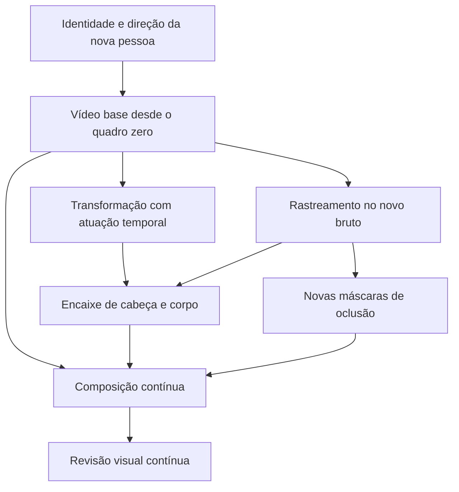

# Recriação com uma nova pessoa desde o primeiro quadro

`editorial_engine.recreation` acrescenta um contrato de produção para recriar a
linguagem de uma referência com outra pessoa. Ele separa o vídeo base da nova
atuação, a aparência transformada e as operações de encaixe/composição. Uma
fotografia animada não preenche a necessidade de atuação temporal da base.

O módulo recebe decisões de direção atribuídas a um autor. Ele não detecta
automaticamente gestos, identidade ou movimento semântico. Sua função é conferir
as consequências dessas decisões, preservar lacunas e produzir solicitações
concretas para execução posterior.

## Dependências



Quando a direção escolher explicitamente `static_overlay`, o conteúdo transformado
pode ser uma imagem e não depende da base para ser criado. Seu encaixe ainda
depende da base e do novo rastreamento. Quando escolher `temporal_performance`, o
conteúdo transformado precisa ser vídeo e declarar qual performance nova orientou
seu movimento. `unknown` mantém a escolha em aberto e não exporta um pedido que
finja já saber o tipo de mídia.

| Etapa | Recurso aceito | Dependências |
|---|---|---|
| `base_video` | Vídeo com atuação temporal | Identidade e direção autoradas |
| `transformed_image_or_video` | Vídeo temporal; imagem ou vídeo de arte estática somente em `static_overlay` | Base para transformação temporal |
| `tracking` | `planar_tracking` ou `pose` | Base efetiva |
| `subject_alignment` | Relatório JSON | Base, transformação e rastreamento atuais |
| `occlusion` | `mattes` | Base e rastreamento atuais |
| `composition` | Vídeo | Todas as camadas e operações anteriores |

A presença de um arquivo gera `supplied_unreviewed`. Esse estado não equivale a
aprovação visual, identificação da pessoa ou validação da atuação.

## API e formatos

```python
from editorial_engine.recreation import (
    build_plan,
    validate_plan,
    production_requests,
    generation_context,
    validate_generation_assets,
)

plan = build_plan(spec, assets=[], verify_files=False)
requests = production_requests(plan)
context = generation_context(plan)

# Depois de receber mídia real, criar nova revisão e registrar os arquivos.
revised_plan = build_plan(revised_spec, actual_assets, verify_files=True)
```

`build_plan` e `validate_plan` conferem contratos, relógios e vínculos. Com
`verify_files=True`, conferem também hashes e tipos reais das imagens/vídeos;
vídeos são inspecionados pelo mesmo leitor de quadros e PTS usado no recebimento
de geração. PNG/JPEG rotulados como vídeo, clocks incorretos e raster incorreto da
base/saída são rejeitados. Essa inspeção técnica não distingue uma atuação natural
de uma sequência visualmente inadequada.

### Especificação

Uma especificação `independent-recreation-spec/1` tem estes campos:

| Campo | Conteúdo |
|---|---|
| `id`, `revision`, `author` | Identificador, revisão e `{kind, actor, method}` do autor |
| `reference` | `{id, sha256, character_id}`; `path` absoluto quando o arquivo está disponível |
| `known_reference_derivative_sha256s` | Hashes conhecidos de recortes, recuperações ou recodificações da referência |
| `target_character` | `{id, identity, reference_ids}`; `null` enquanto a nova identidade não foi escolhida |
| `identity_references` | Imagens efetivas `{id, kind: "image", path, sha256}` citadas pelo alvo |
| `clock` | `{width, height, fps, frame_count}`, FPS como string racional |
| `performance` | Direção autorada com `{id, scope, description, start_frame, end_frame, evidence_ids}` |
| `transformation` | `{motion, description, intervals}`, em que `motion` é `static_overlay`, `temporal_performance` ou `unknown` |
| `alignment` | Direção adicional de enquadramento/encaixe, preservada como contexto para o solver/revisor |

Os intervalos são semiabertos `[start_frame, end_frame)` no relógio final
planejado. `performance.scope` aceita `continuous_video`, `sampled_frames`,
`human_note` ou `user_instruction`. O escopo descreve a origem da instrução, não
uma observação executada por este módulo. Quadros amostrados mantêm a ressalva
`motion_observation_incomplete`; eles não comprovam movimento contínuo.

Exemplo de construção, utilizando um caminho real fornecido pelo host:

```python
from editorial_engine.contracts import file_sha256

spec = {
    "schema": "independent-recreation-spec/1",
    "id": "portal-new-performer",
    "revision": 1,
    "author": {
        "kind": "human",
        "actor": director_name,
        "method": "Direção de recriação baseada na revisão do vídeo e no pedido do usuário",
    },
    "reference": {
        "id": "editing-reference",
        "path": str(reference_path.resolve()),
        "sha256": file_sha256(reference_path),
        "character_id": "reference-performer",
    },
    "target_character": None,
    "clock": {"width": 720, "height": 1280, "fps": "30/1", "frame_count": 504},
    "performance": [{
        "id": "portal-performance",
        "scope": "user_instruction",
        "description": "A nova pessoa executa os gestos de abertura, com movimento de mãos, cabeça e ombros.",
        "start_frame": 0,
        "end_frame": 504,
        "evidence_ids": [],
    }],
    "transformation": {
        "motion": "temporal_performance",
        "description": "Versão estilizada da mesma nova pessoa, acompanhando a atuação do vídeo base.",
        "intervals": [{"start_frame": 0, "end_frame": 504}],
    },
    "alignment": {
        "intent": "Ajustar escala e posição por cabeça, ombros e tronco; recuar a inserção até o encaixe medido.",
    },
}
```

O alvo `null` é uma lacuna válida de planejamento. Os pedidos correspondentes
ficam bloqueados por `target_identity_needed`; o motor não inventa uma nova pessoa
nem aceita mídia já pronta como se essa escolha tivesse ocorrido. Quando houver
um alvo, seu ID precisa ser distinto do ID declarado da pessoa da referência.
IDs distintos não provam que os arquivos retratam pessoas distintas.

### Recursos efetivamente recebidos

Cada recurso fornecido em `assets` identifica uma única etapa por `role`:

```python
base_asset = {
    "id": "new-performance",
    "role": "base_video",
    "kind": "video",
    "path": str(new_video_path.resolve()),
    "sha256": file_sha256(new_video_path),
    "character_id": target_character_id,
    "performance_kind": "temporal_video",
    "fps": "30/1",
    "frame_count": 504,
    "coverage": [{"start_frame": 0, "end_frame": 504, "source_start_frame": 0}],
    "provenance": {
        "kind": "human",
        "actor": director_name,
        "method": "Recebimento de gravação nova; identidade e atuação ainda pendentes de revisão",
        "origin": "new_recording",
        "reference_pixels_used": False,
        "ancestor_sha256s": [],
        "simulated": False,
    },
}
```

Ausências são representadas pela ausência do recurso na lista. Não se fornecem
caminhos ou hashes fictícios para satisfazer etapas. `coverage` relaciona cada
faixa da timeline à faixa de origem do arquivo. A cobertura da base precisa
alcançar todos os quadros, incluindo o quadro zero. Um vídeo com mais quadros pode
declarar trims; não há retime, preenchimento ou repetição automática de quadros.

Os recursos visuais exigem procedência, ID do novo personagem e declaração
explícita `reference_pixels_used: false`. As origens aceitas são
`independent_generation`, `new_recording`, `independent_asset` e `new_composite`.
`ancestor_sha256s` registra a linhagem conhecida. O hash da própria referência,
um derivado conhecido ou a referência em qualquer ancestral declarado impedem a
adoção. Resultados declarados como simulação também são rejeitados.

A transformação temporal acrescenta
`performance_source_sha256: <hash da base nova>`. Ela tem seu próprio relógio e
cobertura, que precisam alcançar todos os intervalos em que será visível. Uma
transformação de imagem aceita somente a opção autorada `static_overlay`.

Rastreamento, alinhamento e oclusão usam:

```python
source_binding = {
    "asset_id": base_asset["id"],
    "source_sha256": base_asset["sha256"],
    "fps": base_asset["fps"],
    "frame_count": base_asset["frame_count"],
}
```

Também declaram `reanchored: true`, `fps`, `frame_count` e `coverage`. Alinhamento e
oclusão identificam o rastreamento por `tracking_sha256`. O alinhamento identifica
a inserção por `transformed_sha256`. A composição lista todos os hashes das cinco
dependências em `dependency_sha256s`. Alterar a base, a transformação ou o
rastreamento exige atualizar os vínculos afetados.

Essas declarações são rastreáveis e verificáveis quanto aos bytes. Elas não
provam que o rastreador foi realmente executado de forma correta, que uma
linhagem omitida não existe ou que a nova pessoa está visualmente presente. O
resultado mantém `source_independence: declared_lineage_only`,
`identity_verified: false` e revisão visual pendente.

## Pedidos de produção

`production_requests` retorna contratos `production-request/1` existentes. Não
chama provedores nem registra adapters. A base exporta `external_video`; uma
transformação estática exporta `chat_image`. Transformações temporais recebem a
base nova como entrada assim que ela existir.

Antes da base real, rastreamento e oclusão permanecem tarefas no plano; nenhum
`source_binding` fictício é criado. Depois da base, passam a ter pedidos tipados
`planar_tracking` e `mattes`. A oclusão permanece bloqueada enquanto seu
rastreamento estiver ausente.

O alinhamento é uma tarefa local descrita em `steps`, com relatório JSON de
entrada. O contrato de produção não tem saída JSON genérica; por isso o módulo
não o disfarça como vídeo ou tracking. O solver de alinhamento existente deve
receber os dados efetivos e produzir seu relatório separadamente.

O pedido de composição usa `manual_asset`, declara seus arquivos de entrada e
mantém as dependências faltantes em `unresolved`. Um adapter concreto de
composição pode ser escolhido pelo host quando todos os recursos necessários
estiverem disponíveis. O pedido em si não comprova um render.

## Recebimento e adoção no projeto persistente

No projeto, a especificação fica em `spec.recreation`. Estes comandos usam
caminhos e IDs ilustrativos; substitua `REQUEST_ID` pelo ID efetivo apresentado
por `status` para a etapa desejada:

```bash
python -m editorial_engine project recreation /caminho/projeto --queue
python -m editorial_engine project status /caminho/projeto
python -m editorial_engine project produce /caminho/projeto REQUEST_ID
```

Um pedido manual é exportado para a ferramenta escolhida. Depois de receber o
arquivo efetivo, registre o resultado e adote-o com seu descritor:

```bash
python -m editorial_engine project receive-resource /caminho/projeto REQUEST_ID /caminho/nova-base.mp4 --provenance /caminho/recebimento.json
python -m editorial_engine project recreation-adopt /caminho/projeto REQUEST_ID /caminho/descritor-base.json
python -m editorial_engine project recreation /caminho/projeto --queue
```

`receive-resource` confere o resultado contra o pedido. Para vídeo comum, isso
inclui o raster, FPS e quantidade de quadros solicitados. A cobertura da timeline
é conferida depois, no descritor de recriação. `full_coverage` é uma exigência
adicional somente nos pedidos de rastreamento e mattes ligados a uma fonte.

`recreation-adopt` usa `project.adopt_recreation_asset(directory, request_id,
descriptor)`. O descritor contém os campos de recurso apresentados acima,
incluindo identidade, atuação, cobertura e procedência. `kind`, `path` e `sha256`
podem ser omitidos: são obtidos do resultado já verificado. Se fornecidos,
precisam corresponder exatamente a ele. O comando não inventa
`ancestor_sha256s`, autoria, nova identidade ou uma declaração de independência.
Procedência ausente e linhagem conhecida da referência impedem a adoção.

O resultado original e suas dependências são congelados antes de avançar o
inventário de recriação. Assim, atualizar a base não reescreve o pedido que a
produziu. Pedidos de direção anteriores ficam obsoletos; o próximo pedido usa os
novos bytes. A nova fila passa a incluir tracking/mattes com `source_binding`
real e a transformação temporal com a base efetiva como entrada.

A etapa seguinte é uma decisão explícita em
`spec.generation_answers.recreation_stage`:

```json
{
  "generation_answers": {
    "recreation_stage": "transformed_image_or_video"
  }
}
```

Esse fragmento pertence à especificação completa do projeto. Grave a revisão
completa e retome a direção:

```bash
python -m editorial_engine project update /caminho/projeto /caminho/spec-proxima-etapa.json --reason "Dirigir a transformação sobre a nova atuação recebida"
python -m editorial_engine project advance /caminho/projeto
```

Os valores disponíveis são `base_video`, `transformed_image_or_video` e
`composition`; a etapa inicial é `base_video`. O pedido seguinte já inclui no
inventário as camadas de base/transformação adotadas, com seus IDs, caminhos,
hashes e `recreation_role`. O comando genérico `fulfill` não substitui essa adoção:
ele informa `recreation_adoption_required` para recursos de recriação, pois não
tem informações suficientes para autorar identidade, atuação e linhagem.

## Integração com o plano de geração

O plano de geração carrega a extensão:

```python
generation_plan["recreation"] = {
    "plan": recreation_plan,
    "stage": "base_video",  # ou transformed_image_or_video ou composition
    "character_id": recreation_plan["spec"]["target_character"]["id"],
}
```

Se o alvo ainda não foi escolhido, `character_id` é `None`. A validação estrutural
continua possível para um rascunho; as lacunas do plano continuam impedindo
declarar o pedido pronto para o provedor.

`validate_generation_assets(recreation_plan, generation_plan)` valida apenas essa
extensão. O validador de geração existente valida o restante do plano. A função
não chama esse validador de volta, permitindo seu uso como hook sem recursão.

| Etapa de geração | Dependências de mídia que precisam estar declaradas |
|---|---|
| `base_video` | Nenhum asset do próprio resultado; a duração final corresponde ao relógio completo |
| `transformed_image_or_video` temporal | Asset `recreation_role: "base_video"`, ainda `needed` no rascunho se necessário |
| `transformed_image_or_video` estática | Nenhuma dependência de atuação temporal |
| `composition` | Assets com `recreation_role: "base_video"` e `"transformed_image_or_video"` |

Uma etapa não pode condicionar sua geração ao próprio resultado ainda ausente.
Essa separação evita pedir dois vídeos completos quando o objetivo atual é
produzir apenas a base. As dependências mantêm sua posição na produção futura.

O personagem na bíblia de geração conserva o ID e o texto de identidade do alvo.
Cada clipe desta produção inclui esse personagem e exclui o ID da pessoa da
referência. Imagens e vídeos de referência conhecidos não podem entrar como
assets fotográficos de geração. Um asset mapeado como pronto precisa corresponder
ao arquivo e ao hash já aceitos no plano de recriação.

O fingerprint de geração precisa incorporar a extensão `recreation`; trocar o
alvo, as necessidades, a base ou a direção de encaixe invalida retornos vinculados
ao plano anterior. Esse vínculo é responsabilidade do hook no módulo de geração.

## O que revisar na saída

Confira em reprodução contínua a presença da nova pessoa desde a abertura, os
gestos necessários, a coerência da identidade, o sincronismo da transformação, o
encaixe de cabeça/ombros/tronco e a oclusão das mãos. Uma inserção grande demais
exige corrigir sua escala e posição sobre a nova geometria. Recuo de camada em
2D não é uma medição de distância real em 3D.

O áudio permanece uma decisão autorada à parte. Este contrato não aprova o mix,
não presume que houve escuta e não transporta automaticamente a trilha da
referência.

Os testes em `tests/test_recreation.py` exercitam cobertura temporal, tipos reais
de mídia, linhagem conhecida, identidade declarada, dependências, vínculos de
rastreamento e estados pendentes. Eles não constituem aprovação estética ou teste
de geração de uma pessoa nova.
